# CI/CD Pipeline with Security Gates

A GitHub Actions pipeline that takes a small Go web service (`pulse`) from commit to production through automated quality and security gates, keyless AWS authentication, a human approval gate, and a **blue-green deployment with automatic rollback** on Kubernetes.

---

## 1. Highlights

- **Security and quality gates** that block a release: formatting, linting, Dockerfile lint, race-detected tests, a 70% coverage floor, SAST (Semgrep), dependency CVEs (govulncheck) and image CVEs (Trivy).
- **No long-lived AWS keys.** GitHub's OIDC token is exchanged for short-lived credentials, with separate **push** and **pull** roles.
- **Build once, promote the same bytes.** Production deploys the exact image **digest** that passed staging; nothing is rebuilt.
- **Blue-green with automatic rollback.** The new version is smoke-tested behind the curtain, switched in, watched for 5 minutes, and switched back automatically if it fails. This happened for real (see [section 6](#6-incident-report-automatic-rollback-in-production)).
- **Human approval gate** before anything reaches production.
- **Observability:** a results table on every run, plus a **DORA metrics** dashboard.

---

## 2. Architecture

```
                    GitHub · Jason2303/cicd-security-gates
 ┌───────────────────────────────────────────────────────────────────────────────┐
 │  trigger: push to main · pull request · manual "Run workflow"                 │
 │                                                                               │
 │  GitHub-hosted runners (fresh VM per job, thrown away afterwards)             │
 │  ┌───────────┐  ┌───────────┐  ┌───────────┐  ┌───────────┐                   │
 │  │   lint    │  │   test    │  │   sast    │  │   deps    │  in parallel      │
 │  │ gofmt     │  │ go test   │  │ Semgrep   │  │ govuln-   │                   │
 │  │ golangci  │  │ -race     │  │ blocks on │  │ check     │                   │
 │  │ hadolint  │  │ cover≥70% │  │ HIGH      │  │           │                   │
 │  └─────┬─────┘  └─────┬─────┘  └─────┬─────┘  └─────┬─────┘                   │
 │        └──────────────┴───────┬──────┴──────────────┘                         │
 │                               ▼                                               │
 │                     ┌───────────────────┐                                     │
 │                     │       build       │  docker build                       │
 │                     │                   │  Trivy: block on fixable CRITICAL   │
 │                     │                   │  main only: push, output digest     │
 │                     └─────────┬─────────┘                                     │
 │                               │ image@sha256:… (job output)                   │
 └───────────────────────────────┼───────────────────────────────────────────────┘
                                 │
        OIDC → push role         │            ┌──────────────────────────────┐
        (write to ECR) ──────────┼──────────▶ │   AWS ECR (private registry) │
                                 │            │   cicd/cicdsecuritypipeline  │
                                 │            └───────────────┬──────────────┘
                                 ▼                            │ OIDC → pull role
 ┌──────────────────────────────────────────────────────────┐ │ (read-only)
 │  Laptop (WSL2) · self-hosted runner [self-hosted, kind]  │◀┘
 │                                                          │
 │   staging job ──────▶ deploy.yml ──▶ deploy.sh staging   │
 │        │ success                                         │
 │        ▼                                                 │
 │   ⏸ production: required reviewer approves              │
 │        ▼                                                 │
 │   production job ───▶ deploy.yml ──▶ deploy.sh production│
 │                     (same digest as staging)             │
 │                                                          │
 │   kind cluster (one Docker container)                    │
 │   ┌───────────────────────┐   ┌───────────────────────┐  │
 │   │ namespace: staging    │   │ namespace: production │  │
 │   │  svc/pulse ──▶ live   │   │  svc/pulse ──▶ live   │  │
 │   │  pulse-blue   (x2)    │   │  pulse-blue   (x3)    │  │
 │   │  pulse-green  (x2)    │   │  pulse-green  (x3)    │  │
 │   └───────────────────────┘   └───────────────────────┘  │
 └──────────────────────────────────────────────────────────┘
                                 │
                                 ▼
   notify (always runs) ──▶ results table on the run's Summary page
   dora-metrics (after every pipeline run) ──▶ DORA dashboard on its Summary page
```

| File                              | Role                                                                        |
| --------------------------------- | --------------------------------------------------------------------------- |
| `.github/workflows/pipeline.yaml` | decides **what** runs and **in what order**                                 |
| `.github/workflows/deploy.yml`    | reusable "deploy to one environment" job, called for staging and production |
| `deploy/deploy.sh`                | the exact blue-green steps run against the cluster                          |

| Trigger                 | What runs                                                      |
| ----------------------- | -------------------------------------------------------------- |
| Pull request to `main`  | all gates + build + image scan. **No push to ECR, no deploy.** |
| Push to `main`          | everything: staging, then production after approval            |
| Manual **Run workflow** | same as a push (useful for re-running a deploy)                |

---

## 3. Quality and security gates

Every gate fails the pipeline with a non-zero exit code; nothing after it runs.

| Gate         | Job          | Tool                               | Fails when                                             |
| ------------ | ------------ | ---------------------------------- | ------------------------------------------------------ |
| Formatting   | `lint`       | `gofmt`                            | any Go file is not formatted                           |
| Code quality | `lint`       | golangci-lint v2.14.0              | any linter finding                                     |
| Dockerfile   | `lint`       | hadolint                           | a Dockerfile best-practice violation                   |
| Tests        | `test`       | `go test -race`                    | a failing test or a data race                          |
| Coverage     | `test`       | `go tool cover`                    | total coverage below **70%**                           |
| SAST         | `sast`       | Semgrep (`p/golang`)               | any **HIGH** (`ERROR`) finding in our code             |
| Dependencies | `deps`       | govulncheck                        | a known CVE in dependency code we **actually call**    |
| Image        | `build`      | Trivy                              | a **CRITICAL** CVE that has a fix available            |
| Approval     | `production` | GitHub Environment                 | a reviewer has not approved                            |
| Smoke test   | `deploy.sh`  | `curl /healthz` on the idle colour | the new version is unhealthy **before** users see it   |
| Health watch | `deploy.sh`  | 30 checks × 10 s after the switch  | the new version fails in front of users → **rollback** |

Each gate was proven to block by pushing a deliberately broken branch:

| Gate failing                                | Gates passing                             |
| ------------------------------------------- | ----------------------------------------- |
| 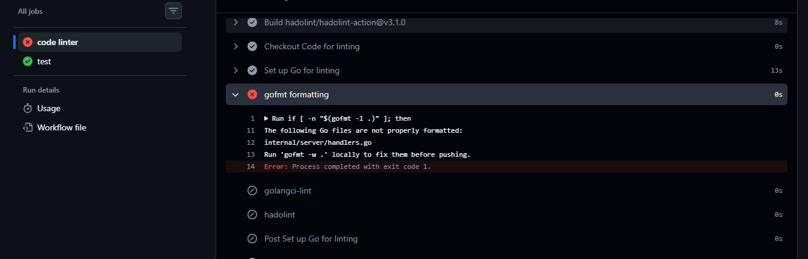 | 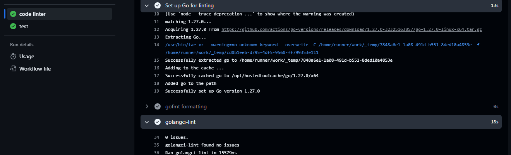 |

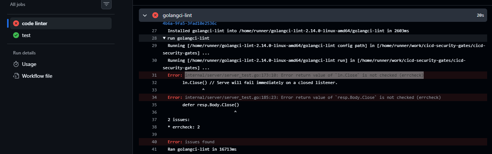
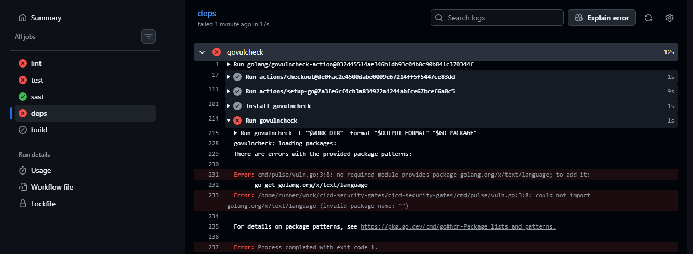
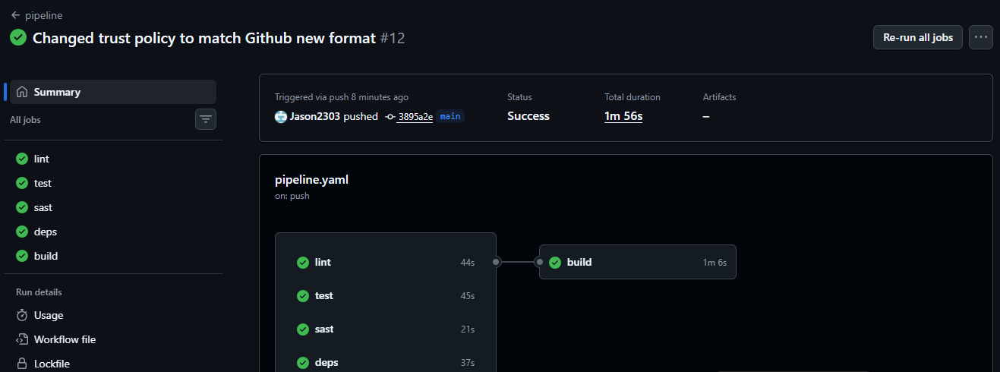

### CVE policy

- **SAST blocks on HIGH**: it's our own code, so we can fix it immediately.
- **Image scan blocks only on CRITICAL**: base-image CVEs are mostly outside our control; blocking on HIGH would stop almost every release.
- **CVEs with no fix available are ignored** (`ignore-unfixed`): blocking on something nobody can fix would also block urgent security releases. The risk is reduced by a minimal **distroless, non-root** runtime image, and the next rebuild picks up fixes as soon as they exist.

### What the 70% coverage gate does not catch

Coverage proves code **ran** during tests, not that the tests **checked** the right things. It can't detect missing assertions, untested edge cases, or integration problems. The smoke test and health watch exist for exactly that gap.

---

## 4. Supply-chain and access security

### Keyless AWS access with OIDC

Each job requests a short-lived signed token from GitHub and exchanges it with AWS STS for temporary credentials. No AWS keys are stored in GitHub.

| Role                                              | Used by                     | Can                |
| ------------------------------------------------- | --------------------------- | ------------------ |
| `github-actions-cicd-security-gates-ecr-push`     | `build` (GitHub-hosted)     | push images to ECR |
| `github-actions-cicd-security-gates-ecr-pull-k8s` | deploy jobs (laptop runner) | **pull only**      |

Separate roles limit the blast radius: a compromised laptop runner can read images but can never plant one.

The trust policies match the token's `sub` claim exactly. GitHub's `sub` includes the owner's and repository's **numeric IDs**, so a deleted-and-recreated repository with the same name can't inherit the trust.

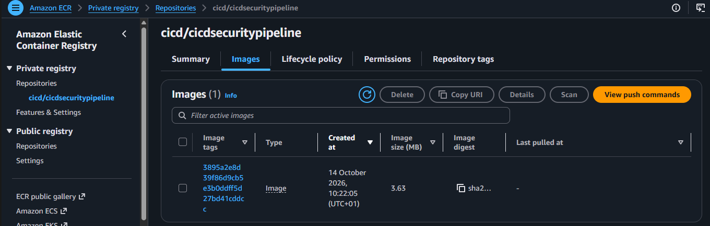

### Hardening

- **Actions pinned by commit SHA**, with the version in a comment. Tags can be moved to point at malicious code (the March 2026 trivy-action incident); a SHA can't.
- **No `${{ }}` inside `run:`.** Every input reaches the shell through `env:`, so a value like a branch name can never be executed as code (script injection).
- **Least privilege by default.** Workflow default is `contents: read`; only `build`, `staging` and `production` add `id-token: write`. The calling job sets the ceiling for the reusable workflow.
- **The self-hosted runner never runs untrusted code.** Deploy jobs only run on `main` (push or manual run), never on pull requests, so code from a fork can't reach the laptop. The runner runs as a dedicated unprivileged user with a namespace-scoped, expiring cluster token.
- **Runtime container:** distroless, non-root (UID 65532), read-only root filesystem, all Linux capabilities dropped, no service-account token mounted.

---

## 5. Deployment: blue-green on Kubernetes

Each namespace runs **two full copies** of the app, "blue" and "green" (a `color` label on two Deployments), and **three Services**:

| Kubernetes object                           | Selects                 | Purpose                                         |
| ------------------------------------------- | ----------------------- | ----------------------------------------------- |
| `Deployment/pulse-blue`                     | pods `color: blue`      | one colour                                      |
| `Deployment/pulse-green`                    | pods `color: green`     | the other colour                                |
| `Service/pulse-blue`, `Service/pulse-green` | always their own colour | reach a colour directly, for the **smoke test** |
| `Service/pulse`                             | `color: <live>`         | the front door users hit; **the switch**        |

Services never point at other Services; all three select pods directly. `Service/pulse` points at exactly one colour at a time, and `kubectl patch` flips it.

### What `deploy.sh` does

1. **Find live and idle:** read `Service/pulse`'s selector; the other colour is idle.
2. **Detect opening night:** if the live colour still runs the bootstrap placeholder image, `BOOTSTRAP=true` (there is nothing to roll back to).
3. **Refresh the ECR pull secret:** ECR passwords expire after 12 hours.
4. **Deploy to idle:** `kubectl set image`, then `kubectl rollout status --timeout=180s`.
5. **Smoke test, curtain closed:** `curl /healthz` through the idle colour's own Service. Failure stops here; **users are never affected**.
6. **Switch:** `kubectl patch` `Service/pulse` to the idle colour. The only step that affects users; near-instant, no pod restarts.
7. **Health watch:** 30 checks, 10 s apart (~5 min), through the live Service.
8. **Rollback:** on failure, patch `Service/pulse` back to the old colour (retried up to 6 times), report `ROLLED BACK`, fail the job. On opening night, fail loudly instead.

The old colour keeps running after the switch, which is why rollback takes seconds. The cost is **double the pods**.

### Promotion: same digest, staging → production

`build` publishes the pushed image's **digest** (`sha256:…`) as a job output. Both deploy jobs receive that same value, so production runs byte-for-byte what passed staging. A rebuild could produce a different image (newer base layers, different dependencies).

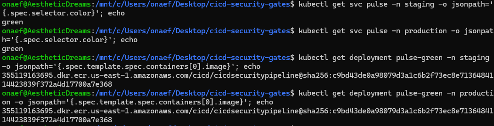

### Approval gate

The `production` GitHub Environment requires a reviewer. The job stops at **"Waiting for review"** until approved.

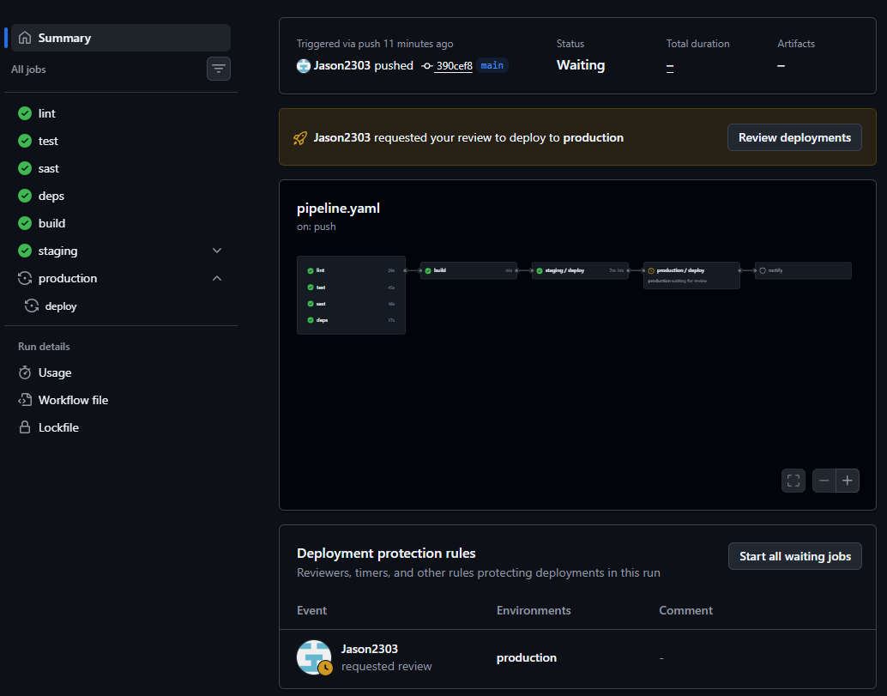

`concurrency: deploy-<environment>` ensures only one deploy per environment runs at a time; a newer one waits.

---

## 6. Incident report: automatic rollback in production

### Incident 1: the rollback works (16 Oct 2026, ~20:20 WAT)

| Time          | Event                                                                                        |
| ------------- | -------------------------------------------------------------------------------------------- |
| T+0           | Production deploy: new version to **blue**, smoke test passed, traffic switched green → blue |
| T+0 → T+4 min | Health checks 1-25 OK                                                                        |
| T+4 min       | Check 26: `curl: (52) Empty reply from server`                                               |
| T+4 min       | `deploy.sh` patched `Service/pulse` back to **green**: `ROLLED BACK`, job red                |

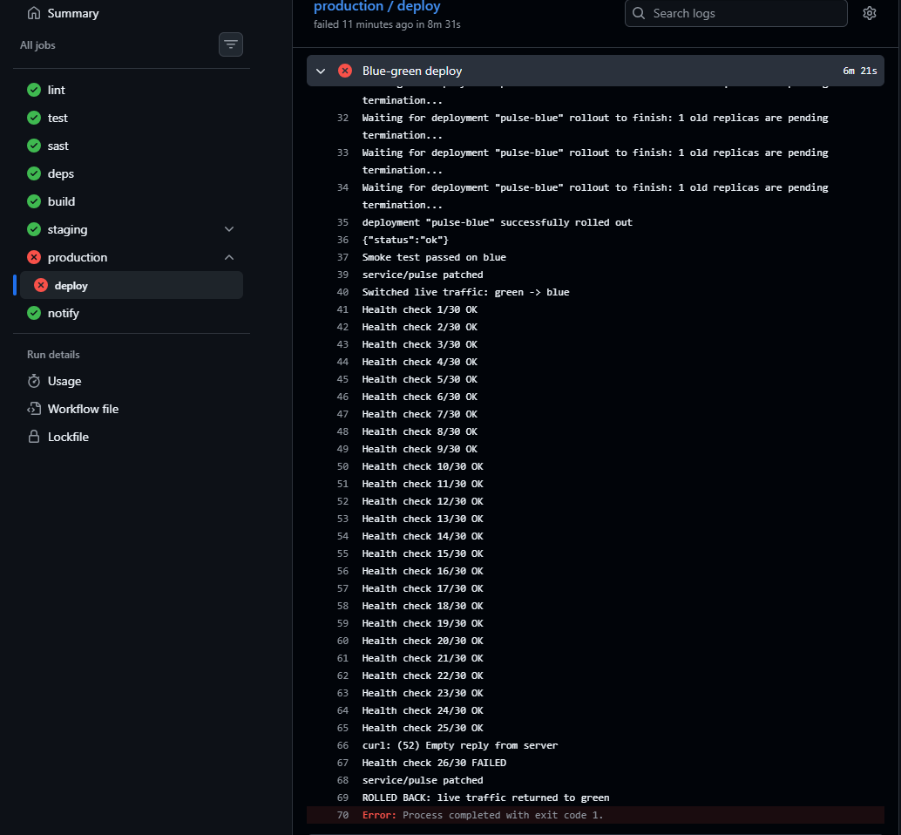

**Root cause:** every pod (blue **and** green) showed `Completed exit=0` and the event `Container pulse failed liveness probe, will be restarted`. The app hadn't crashed; the kubelet had shut it down. The kind node was CPU-starved (`kube-apiserver` at 111% CPU, load average 23.85 on 4 cores), so `/livez` couldn't answer within the default 1-second probe timeout. Three misses → restart.

**Fixes:** probe `timeoutSeconds` raised to 5 s (liveness) and 3 s (readiness); restart the kind control plane before each deploy session.

### Incident 2: the rollback itself failed silently (~21:29 WAT)

Health check 2 got `Connection reset by peer`, and the script tried to roll back, but the cluster answered the rollback's `kubectl patch` with `TLS handshake timeout`. `set -e` stopped the script, and **the rollback never happened**. Production was left on the new colour while the job just showed red. It was verified healthy (0 restarts, `/healthz` OK) and deliberately left in place.

**Fixes:**

- The rollback `kubectl patch` is retried up to 6 times, 10 s apart, and prints a loud `ROLLBACK FAILED` error with manual instructions if all attempts fail.
- Health checks use `curl --retry-all-errors`, so a single dropped connection is retried instead of triggering a rollback. A genuinely unhealthy app (HTTP 503) still fails within seconds.

**Lesson:** the step that protects users must be the most stubborn one, and must fail loudly.

---

## 7. Observability

### Run summary

The `notify` job runs on every pipeline run (`if: always()`), even when something failed, and writes each job's result plus the deployed digest to the run's **Summary** page.

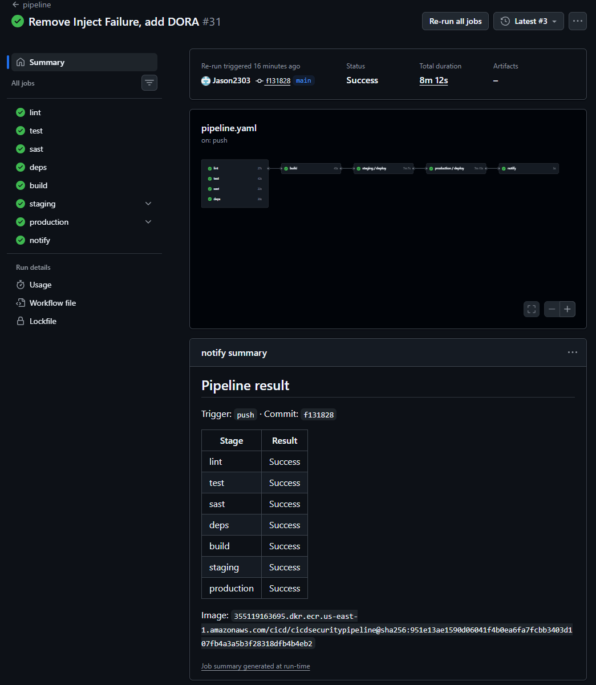

### DORA metrics

`dora-metrics` runs after every pipeline run (or on demand) and computes the four DORA metrics for **production** from the run history (`scripts/dora.py`). Find it under **Actions → dora-metrics → latest run → Summary**.

| Metric                | How it is measured here                                                            |
| --------------------- | ---------------------------------------------------------------------------------- |
| Deployment frequency  | successful `production / deploy` jobs per week                                     |
| Lead time for changes | commit time → production deploy finished (median; includes the approval wait)      |
| Change failure rate   | failed production deploys (including automatic rollbacks) ÷ all production deploys |
| Time to restore       | failed production deploy → next successful one (median)                            |

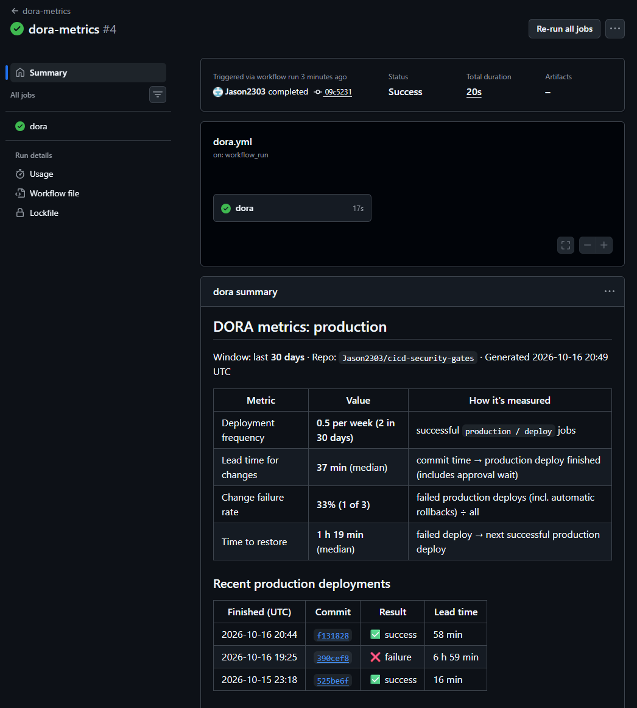

---

## 8. Design decisions

- **One reusable deploy workflow instead of a `matrix`.** Staging and production come from the same pipeline and the same `deploy.yml`. A matrix would run the environments **side by side**; here production must wait for staging to succeed and for human approval, so they are two jobs linked by `needs:`.
- **CI on GitHub-hosted runners, CD on a self-hosted runner.** Gates run on clean, disposable VMs. GitHub's machines can't reach a local kind cluster, so deploys run on a runner on the same laptop, restricted as described in section 4.
- **Blue-green over rolling or canary.** Instant, complete rollback and a pre-switch smoke test, at the cost of double the pods. Canary would expose a fraction of users to a bad version; rolling makes rollback another slow rollout.
- **Promote by digest, never by tag.** Tags can be moved; a digest identifies one exact image.
- **No synthetic rollback drill.** A failure-injection switch was built, then removed: the real incident in section 6 exercised the rollback path in production, which is stronger evidence than a staged drill.
- **No load test (k6).** On a single-laptop cluster, results would mostly measure the laptop. It would fit between staging and production in a real environment.

---

## 9. Repository layout

```
cicd-security-gates/
├── .github/workflows/
│   ├── pipeline.yaml        # CI/CD: gates → build → staging → production → notify
│   ├── deploy.yml           # reusable deploy job (called once per environment)
│   └── dora.yml             # DORA metrics dashboard, runs after each pipeline
├── cmd/pulse/main.go        # app entry point
├── internal/server/         # HTTP server: /healthz, /readyz, /livez + tests
├── deploy/
│   ├── deploy.sh            # blue-green deploy, smoke test, health watch, rollback
│   └── k8s/
│       ├── app/             # colourless Deployment + Service template
│       ├── colors/          # blue/ and green/: name suffix + color label
│       ├── base/            # both colours + live Service "pulse" (the switch)
│       └── overlays/        # staging (2 replicas) and production (3 replicas)
├── scripts/dora.py          # computes the four DORA metrics from run history
├── images/                  # screenshots used in this README
├── Dockerfile               # multi-stage build → distroless, non-root
├── .gitattributes           # forces LF line endings
└── go.mod
```

---

## 10. Setup and Operations Guide

Everything below runs in **WSL** (Ubuntu) unless marked **PowerShell** or **GitHub UI**.

### 10.1 Prerequisites

| Tool                                   | Used for                 |
| -------------------------------------- | ------------------------ |
| Docker Desktop (WSL2 backend)          | runs the kind cluster    |
| kind, kubectl                          | local Kubernetes cluster |
| AWS CLI v2                             | ECR and IAM setup        |
| An AWS account and a GitHub repository | registry and pipeline    |

### 10.2 Create the cluster and namespaces

```bash
kind create cluster --name cicd
kubectl create namespace staging
kubectl create namespace production
kubectl get nodes          # expect: cicd-control-plane   Ready
```

### 10.3 Create the ECR repository

```bash
aws ecr create-repository --repository-name cicd/cicdsecuritypipeline --region us-east-1
```

### 10.4 Let GitHub Actions log in to AWS with OIDC

Register GitHub as an identity provider (once per AWS account):

```bash
aws iam create-open-id-connect-provider \
  --url https://token.actions.githubusercontent.com \
  --client-id-list sts.amazonaws.com
```

Print the real token's `sub` once (temporary debug step) and copy it exactly into the trust policy. Ours:

- deploy jobs: `repo:Jason2303@86899893/cicd-security-gates@1417581777:environment:staging` (and `:environment:production`)
- build job: `repo:Jason2303@86899893/cicd-security-gates@1417581777:ref:refs/heads/main`

`pull-trust.json` (the push role is the same, with the build job's `sub`):

```json
{
  "Version": "2012-10-17",
  "Statement": [
    {
      "Effect": "Allow",
      "Principal": {
        "Federated": "arn:aws:iam::<ACCOUNT_ID>:oidc-provider/token.actions.githubusercontent.com"
      },
      "Action": "sts:AssumeRoleWithWebIdentity",
      "Condition": {
        "StringEquals": {
          "token.actions.githubusercontent.com:aud": "sts.amazonaws.com",
          "token.actions.githubusercontent.com:sub": [
            "repo:Jason2303@86899893/cicd-security-gates@1417581777:environment:staging",
            "repo:Jason2303@86899893/cicd-security-gates@1417581777:environment:production"
          ]
        }
      }
    }
  ]
}
```

`pull-policy.json`:

```json
{
  "Version": "2012-10-17",
  "Statement": [
    {
      "Effect": "Allow",
      "Action": "ecr:GetAuthorizationToken",
      "Resource": "*"
    },
    {
      "Effect": "Allow",
      "Action": [
        "ecr:BatchGetImage",
        "ecr:GetDownloadUrlForLayer",
        "ecr:BatchCheckLayerAvailability"
      ],
      "Resource": "arn:aws:ecr:us-east-1:<ACCOUNT_ID>:repository/cicd/cicdsecuritypipeline"
    }
  ]
}
```

The push role's policy adds `ecr:InitiateLayerUpload`, `ecr:UploadLayerPart`, `ecr:CompleteLayerUpload` and `ecr:PutImage` on the same repository.

```bash
aws iam create-role --role-name github-actions-cicd-security-gates-ecr-pull-k8s \
  --assume-role-policy-document file://pull-trust.json
aws iam put-role-policy --role-name github-actions-cicd-security-gates-ecr-pull-k8s \
  --policy-name ecr-pull --policy-document file://pull-policy.json
# repeat with push-trust.json / push-policy.json for github-actions-cicd-security-gates-ecr-push
```

> `Not authorized to perform sts:AssumeRoleWithWebIdentity` also appears when the **role name** in the workflow doesn't exist in IAM, not only when the trust policy is wrong.

### 10.5 GitHub environments and approval gate (GitHub UI)

1. **Settings → Environments → New environment**: create `staging` and `production`.
2. In `production`: tick **Required reviewers**, search by **username** (not email), leave **Prevent self-review** unticked if you are the only reviewer, then click **Save protection rules**.
3. Prove it: the next production deploy must stop at **"Waiting for review"**.

### 10.6 Self-hosted runner on the laptop

Run it as a dedicated, unprivileged user:

```bash
sudo useradd -m -s /bin/bash ghrunner
sudo -iu ghrunner bash -c '
  mkdir actions-runner && cd actions-runner
  # download + extract the runner: GitHub UI → Settings → Actions → Runners → New self-hosted runner (Linux x64)
  ./config.sh --url https://github.com/Jason2303/cicd-security-gates --token <REGISTRATION_TOKEN> --labels kind --unattended
'
```

Give `ghrunner` a kubeconfig scoped to the two namespaces (a `deployer` ServiceAccount whose Role can get/patch Deployments and Services, create/patch Secrets, list Pods and create `pods/portforward`), with a short-lived token:

```bash
kubectl create token deployer -n staging --duration=168h   # 7 days, then renew
```

The runner also needs `kubectl` and the AWS CLI on its PATH.

### 10.7 One-time bootstrap

Creates both colours (with a placeholder image) and the live Service in each namespace:

```bash
kubectl apply -k deploy/k8s/overlays/staging
kubectl apply -k deploy/k8s/overlays/production
```

> ⚠️ **Never apply wholesale again.** It would reset the live colour's image to the placeholder and the live selector to `blue`. After bootstrap, `deploy.sh` owns the image and the selector.

The first deploy detects the placeholder (`BOOTSTRAP=true`), deploys to the idle colour and switches to it.

### 10.8 Before every deploy session

```bash
# 1. Windows: open Docker Desktop and wait for "Engine running"
# 2. Restart the cluster (kind's control plane degrades after hours of uptime on a laptop)
docker restart cicd-control-plane && sleep 120
kubectl get nodes                                    # expect: Ready
# 3. Start the runner and leave the window open
sudo -iu ghrunner bash -c 'cd actions-runner && ./run.sh'   # expect: Listening for Jobs
```

### 10.9 Deploy

**PowerShell** (pushes go from Windows, where GitHub credentials live):

```powershell
git add <files>
git commit -m "<message>"
git push origin main
```

Then in **Actions**: watch staging, approve production at **"Waiting for review"**, read the run's **Summary** page. Add `[skip ci]` to the commit message for documentation-only changes.

### 10.10 Verify

```bash
kubectl get svc pulse -n staging    -o jsonpath='{.spec.selector.color}'; echo
kubectl get svc pulse -n production -o jsonpath='{.spec.selector.color}'; echo
# Both live colours should run the SAME digest (production = what passed staging)
for ns in staging production; do
  live=$(kubectl get svc pulse -n "$ns" -o jsonpath='{.spec.selector.color}')
  kubectl get deployment "pulse-$live" -n "$ns" -o jsonpath='{.spec.template.spec.containers[0].image}'; echo
done
```

### 10.11 Troubleshooting

| Symptom                                             | Cause                                   | Fix                                                     |
| --------------------------------------------------- | --------------------------------------- | ------------------------------------------------------- |
| `connection refused` from kubectl                   | Docker Desktop closed                   | open Docker Desktop; the kind container restarts itself |
| `TLS handshake timeout`, "spec update not observed" | kind control plane starved of CPU       | `docker restart cicd-control-plane`                     |
| Pods restart with `failed liveness probe`           | probe timeout too strict on a busy node | probes use `timeoutSeconds: 5` / `3`                    |
| `ImagePullBackOff`                                  | expired ECR password in `ecr-pull`      | re-run the deploy; `deploy.sh` refreshes it every run   |
| `docker: command not found` in WSL                  | Docker Desktop not running              | start Docker Desktop                                    |

---

## 11. Lessons learned

1. **A gate isn't proven until you've seen it block.** The production approval rule wasn't saved the first time; the first deploy sailed straight through.
2. **The step that protects users must retry and fail loudly.** A single-attempt rollback failed silently during a cluster hiccup (section 6).
3. **Liveness probes can kill healthy apps.** A 1-second timeout on a busy node restarted every pod at once.
4. **`$(cmd1; cmd2)` reports only `cmd2`'s exit code**, so `set -e` misses a failing `cmd1`. Put risky command substitutions on their own line.
5. **`curl` exits 0 on HTTP 503 unless you add `-f`**, and only retries some errors unless you add `--retry-all-errors`.
6. **Workflow-level `env:` doesn't cross into a reusable workflow**; only `inputs` and `secrets` do.
7. **The calling job sets the permissions ceiling.** It must grant `id-token: write`; the called workflow can only keep or reduce it.
8. **A job can only read outputs of jobs it lists directly in `needs:`.**
9. **"Not authorized to AssumeRoleWithWebIdentity" can mean "no role with that name".** Printing the real token's `sub` and `aud` found it.
10. **YAML indentation is meaning.** A mis-indented `run:` silently became an environment variable.
11. **CRLF line endings break tools.** Files edited on Windows failed `gofmt`; `.gitattributes` now forces LF.
12. **kind is one Docker container.** No Docker Desktop, no cluster; long uptime on a laptop degrades the control plane.

---

## 12. Limitations and next steps

| Limitation                                                              | Next step                                                                     |
| ----------------------------------------------------------------------- | ----------------------------------------------------------------------------- |
| Single laptop runner and a kind cluster: one machine, limited CPU       | managed Kubernetes (e.g. EKS) with the runner in-cluster or ephemeral         |
| The runner's cluster token is a 7-day secret                            | cloud cluster with OIDC-based access, so no stored cluster credentials remain |
| Health checks go through `port-forward`, which pins to **one pod**      | probe through an ingress, or check every pod                                  |
| Nothing verifies the pods serve the **new** digest                      | add a `/version` endpoint and compare it to the expected SHA                  |
| Rollback is unsafe with **database migrations** (old code + new schema) | backward-compatible migrations (expand → migrate → contract)                  |
| Semgrep's container image is pinned by tag, not digest                  | pin by digest; let Dependabot bump pinned actions and images                  |
| No load test, no chat notifications                                     | k6 between staging and production; Slack message from `notify`                |
